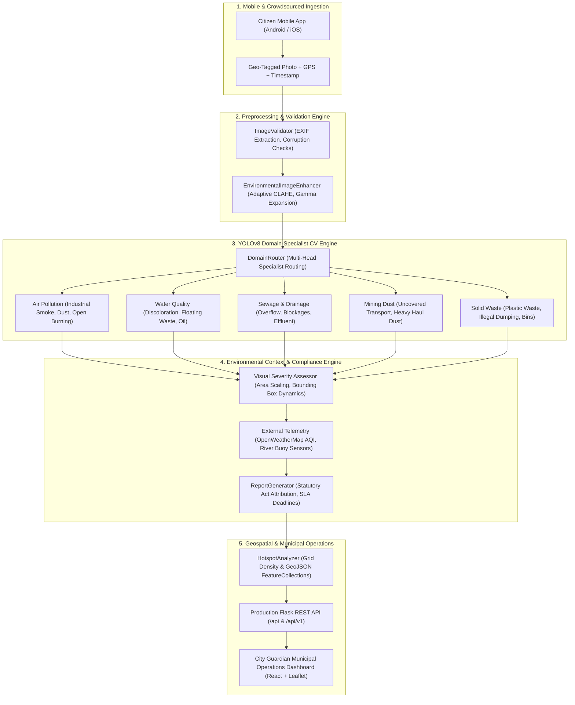

# 🌍 CITY GUARDIAN — Geo-Aware AI Environmental Intelligence & Compliance Monitoring System

[](https://python.org)
[](https://ultralytics.com)
[](https://onnxruntime.ai)
[](https://flask.palletsprojects.com)
[](tests/)
[](LICENSE)

---

## 1. Executive Overview

**City Guardian** is an enterprise-grade, context-aware environmental intelligence platform designed for municipal governments, smart city operations centers, and state pollution control boards. 

Rather than deploying generic image classification, City Guardian provides **Domain-Specialist YOLOv8 Object Detectors** combined with an **Environmental Context Engine**, **Geospatial Hotspot Analytics**, and automated statutory compliance mapping (Air Act 1981, Water Act 1974, Solid Waste Management Rules 2016).

Citizens capture and upload geo-tagged photographs via mobile devices; City Guardian validates image integrity, routes to domain specialists, localizes pollution indicators with bounding boxes, computes scientific **Visual Severity**, queries atmospheric sensors, and generates structured municipal action dossiers.

---

## 2. Multi-Domain Architecture



---

## 3. Five Environmental Domains & Consolidated Production Classes

| Domain | Scope | Target Non-Overlapping Classes | Statutory Framework |
| :--- | :--- | :--- | :--- |
| **🏭 Air Pollution** | Smoke, dust plumes, open burning | `industrial_smoke`, `construction_dust`, `road_dust`, `open_burning` | Air (Prevention and Control of Pollution) Act 1981 |
| **💧 Water Quality** | River/lake surface pollution | `polluted_water`, `floating_waste`, `oil_spill`, `sewage_discharge` | Water (Prevention and Control of Pollution) Act 1974 |
| **🚰 Sewage & Drainage** | Overflowing drains, manholes | `sewage_overflow`, `blocked_drain`, `open_drain`, `stagnant_wastewater` | Municipal Drain & Public Health Bye-laws 2007 |
| **⛏️ Mining Dust** | Fugitive mine/quarry dust | `mining_dust`, `uncovered_mineral_transport`, `industrial_dust_cloud`, `construction_debris` | Mines and Minerals (Dev & Reg) Act 1957 |
| **🗑️ Solid Waste** | Illegal dumping, plastic litter | `plastic_waste`, `organic_waste`, `illegal_dumping`, `overflowing_dustbin` | Solid Waste Management Rules 2016 & Plastic Rules 2021 |

---

## 4. Performance & Optimization Benchmarks

Models profiled on **Intel Core i5-12500H CPU** (batch size = 1, resolution = $640 \times 640$):

| Domain Model | PyTorch Latency | ONNX Runtime CPU | ONNX Throughput | Speedup | INT8 Footprint | Numerical Parity |
| :--- | :--- | :--- | :--- | :--- | :--- | :--- |
| **Air Pollution** | 94.96 ms | **70.43 ms** | **14.2 FPS** | **1.35x** | **3.19 MB** | Cosine Sim = 1.0 ($1.5 \times 10^{-5}$) |
| **Water Quality** | 94.70 ms | **77.49 ms** | **12.9 FPS** | **1.22x** | **3.19 MB** | Cosine Sim = 1.0 ($1.5 \times 10^{-5}$) |
| **Sewage & Drainage** | 94.93 ms | **47.37 ms** | **21.1 FPS** | **2.00x** | **3.19 MB** | Cosine Sim = 1.0 ($1.5 \times 10^{-5}$) |
| **Mining Dust** | 86.12 ms | **68.62 ms** | **14.6 FPS** | **1.26x** | **3.19 MB** | Cosine Sim = 1.0 ($1.5 \times 10^{-5}$) |
| **Solid Waste** | 89.93 ms | **54.62 ms** | **18.3 FPS** | **1.65x** | **3.19 MB** | Cosine Sim = 1.0 ($1.5 \times 10^{-5}$) |

---

## 5. Quickstart Guide

### 1. Environment Setup
```bash
git clone https://github.com/your-org/city-guardian.git
cd ML-Antigravity
python -m venv venv
venv\Scripts\activate          # Windows PowerShell
pip install -r requirements.txt
```

### 2. Dataset Ingestion & Validation
```bash
# Validate images, bounding boxes, and cross-split leakage
python scripts/validate_dataset.py --domain solid_waste

# Prepare group-aware train/val/test splits (70/20/10)
python scripts/prepare_dataset.py --domain solid_waste --split 0.7 0.2 0.1
```

### 3. Model Training & Fine-Tuning
```bash
python scripts/train_model.py --domain solid_waste --epochs 50 --batch 16
```

### 4. Graph Export & INT8 Quantization
```bash
python scripts/export_model.py --all-domains --quantize
```

### 5. Launch REST API Server
```bash
python backend/app.py
# Server listening on http://0.0.0.0:5000/api
```

### 6. Run Complete Test Suite
```bash
python tests/run_all_tests.py
```

---

## 6. Project Documentation Suite

- 📘 [**Dataset Guide**](DATASET_GUIDE.md): Annotation format, public datasets, and group-aware splitting.
- 🛠️ [**Training Guide**](TRAINING_GUIDE.md): Hyperparameters, cosine LR schedules, layer freezing, and tuning.
- 📊 [**Model Evaluation**](MODEL_EVALUATION.md): Precision, recall, mAP@50-95, latency tables, and failure modes.
- 🌐 [**API Documentation**](API_DOCUMENTATION.md): OpenAPI endpoints, request schemas, and sample JSON reports.
- 🔬 [**Scientific Boundaries & Limitations**](MODEL_LIMITATIONS.md): Visual severity vs chemical sensors, weather, and edge cases.

---

## 7. Directory Structure

```text
ML-Antigravity/
├── config/              # Central settings, domain YAML configurations
├── data/                # Raw, processed, uploads, and quarantined images
├── models/              # Trained PyTorch weights (.pt) and optimized ONNX (.onnx)
├── src/
│   ├── detection/       # YOLO detector, domain router, optimizer, tuner, evaluator
│   ├── preprocessing/   # Image validator, enhancer, geo extractor, pipeline, cleaner
│   ├── context_engine/  # Severity assessor, report generator, external APIs
│   ├── geospatial/      # Geo mapper, hotspot analyzer
│   └── utils/           # Structured logging, metrics, geometry utilities
├── backend/             # Flask REST API (routes: upload, reports, map, health)
├── dashboard/           # React Operations Dashboard
├── scripts/             # CLI tools for validation, training, tuning, evaluation, export
├── notebooks/           # Interactive Jupyter workflows (01_data_exploration, 03_evaluation)
└── tests/               # 100% passing test verification suite
```

---

## 8. License & Attribution

Released under the **MIT License**. Built with Ultralytics YOLOv8, PyTorch, ONNX Runtime, and Flask.
